# Actividad 2.2 – Certificados

**Alumno:** Timur Asecov  
**Curso:** DAW2

## Evidencia 0

En estas capturas se puede ver que la instancia está en ejecución, tiene una IP elástica asignada y cuenta con las reglas de entrada solicitadas.

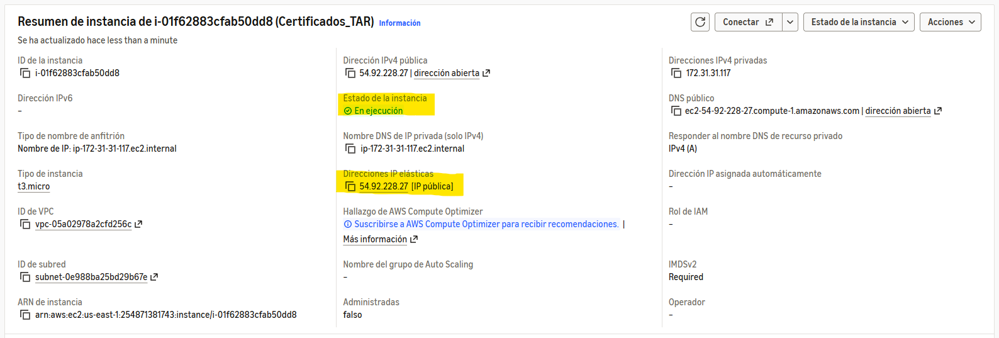

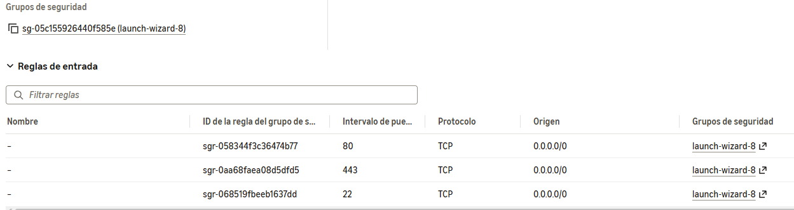

## Evidencia 1

Aquí se ve que Apache se instaló correctamente y se está ejecutando.

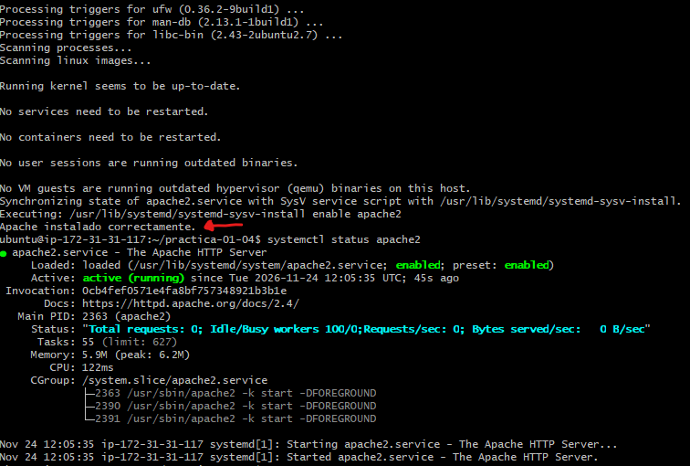

## Evidencia 2

En caso de que se intentara instalar Apache de nuevo, saldría el siguiente mensaje.

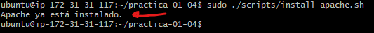

## Evidencia 3

Aquí se puede ver que la configuración de HTTPS y la salida del certificado son correctas.

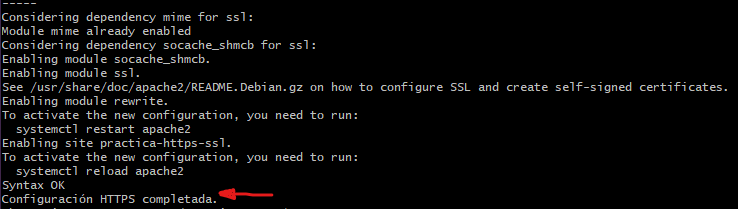

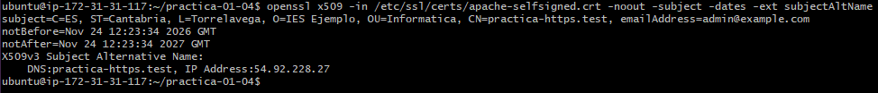

## Evidencia 4

Comprobamos que la configuración de Apache es correcta.

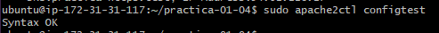

## Evidencia 5

Aquí se puede ver cómo Apache está escuchando los puertos 443 y 80.

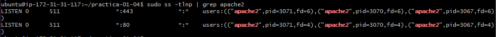

## Evidencia 6

HTTP se ha redireccionado correctamente.

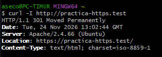

## Evidencia 7

HTTPS funciona correctamente.

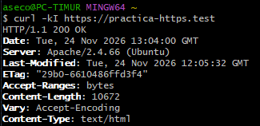

## Evidencia 8

Aquí se puede ver que la negociación con TLS es correcta. En la salida se muestran el protocolo TLS, el cifrado utilizado y el certificado presentado.

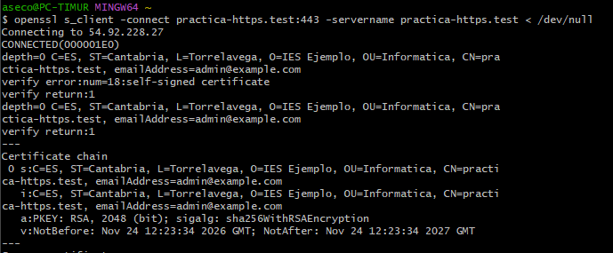

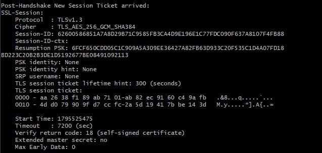

## Evidencia 9

Tras pasar el aviso que aparece al ser un certificado autofirmado, comprobamos que aparece correctamente la página por defecto de Apache. También podremos consultar los detalles del certificado.

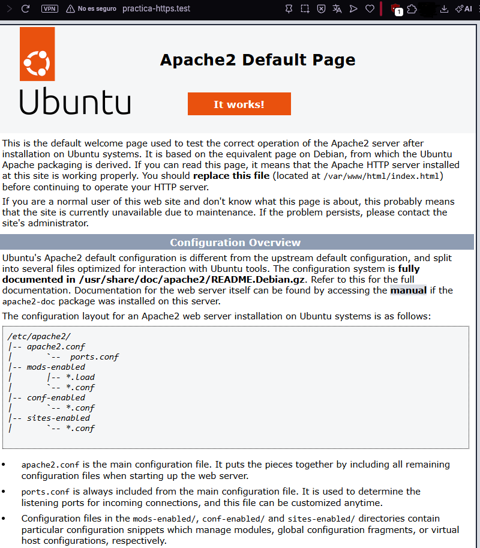

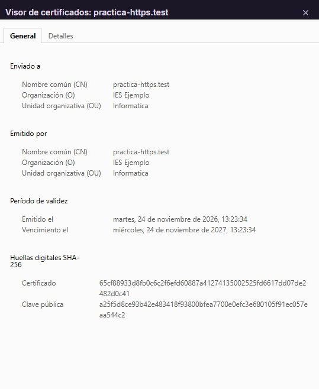

## Evidencia extra

También se puede ver que es posible hacerlo con IP.

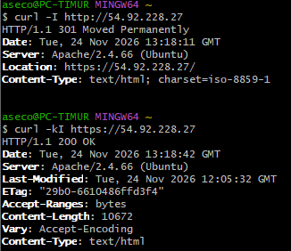
